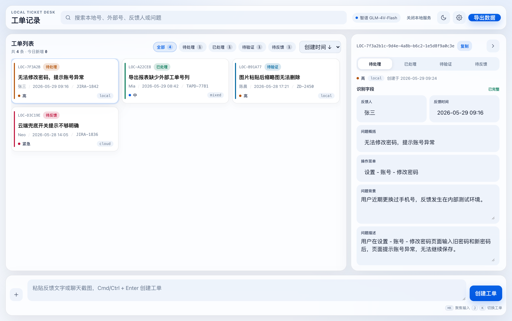
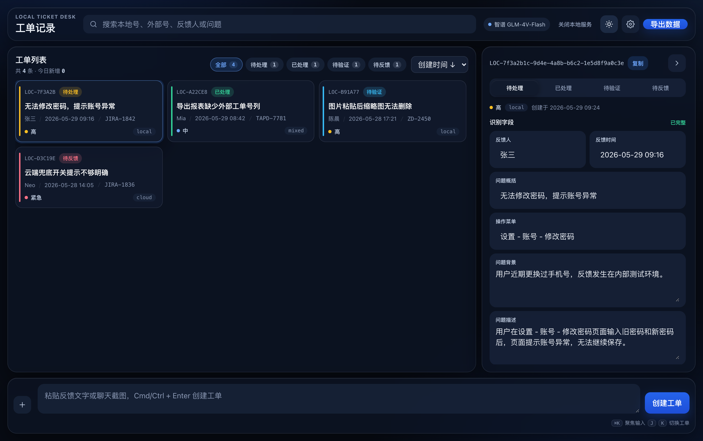
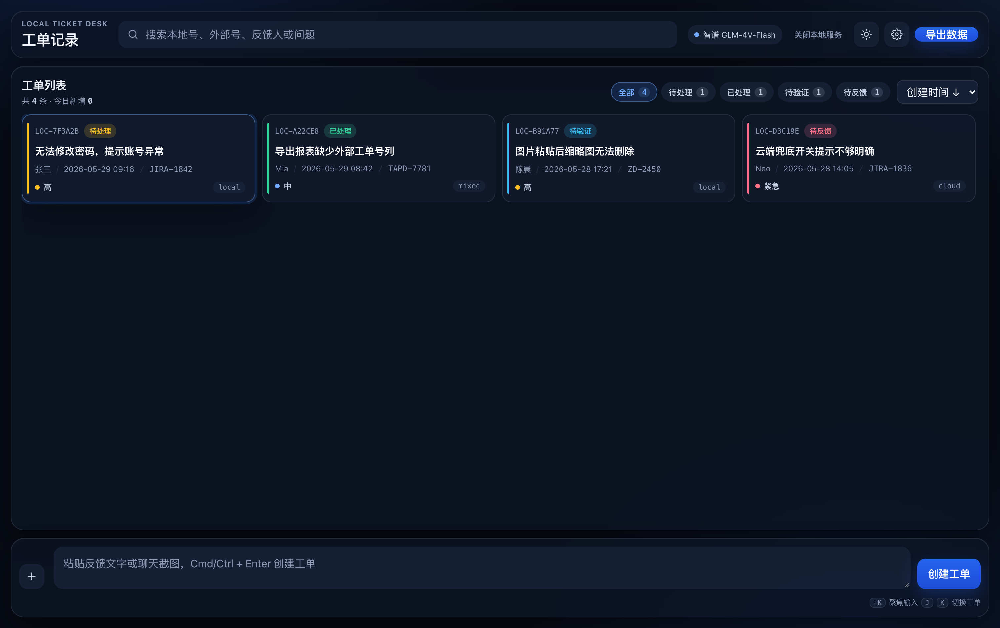

# 工单记录小工具 Local Ticket Desk

一款本地优先的工单记录工具。把 IM 里的碎片化反馈（文字、截图）快速转成可追踪、可导出、可审计的结构化工单。

它不替代 Jira、TAPD、禅道这类研发协同系统，而是作为反馈进入正式系统前后的轻量记录层：本地工单号负责工具内唯一标识，外部工单号负责关联正式系统。



<details>
<summary>查看夜间模式与列表视图</summary>





</details>

## 特性

- **本地优先**：默认离线运行，不联网、不上传截图与文本
- **两条识别路线**：本地 Ollama（免费离线）或联网模型（默认智谱 GLM-4V-Flash，可切换 DeepSeek、通义千问、Kimi 等）
- **macOS 系统 OCR**：调用系统 Vision 框架提取截图文字，200 到 300 毫秒完成，无模型也能用
- **识别失败不丢素材**：连接失败时文字与截图保留在输入框，可重试或直接创建草稿
- **完整工单能力**：结构化字段、人工校正、状态流转、操作日志、搜索筛选、CSV 与 Excel 导出
- **双主题**：日间白蓝、夜间黑蓝，均可达到 WCAG AA 对比度
- **快捷键**：`Cmd+K` 聚焦输入、`J`/`K` 切换工单、`Cmd+Enter` 提交、`Esc` 收起详情

## 快速开始

环境要求：macOS、Node.js 18 以上。

```bash
git clone <本仓库地址>
cd jira
npm install --prefix code      # 安装依赖（better-sqlite3）
node code/server.js            # 启动本地服务
```

然后访问 http://127.0.0.1:4173

也可以直接双击项目根目录的 `start.command`：它会自动检查依赖、启动服务并打开浏览器。服务只监听本机回环地址，不对外网开放。

首次启动会自动写入 4 条示例工单，数据库文件位于 `code/tickets.db`。

## 配置识别方式

打开页面右上角「设置」，在「AI 识别」中选择识别方式。

### 本地 Ollama（推荐，免费离线）

```bash
# 1. 安装并启动 Ollama（https://ollama.com）
# 2. 拉取一个视觉模型
ollama pull qwen3-vl:4b        # 8GB 内存可用；内存充足可选 qwen3-vl:8b
```

在设置中选择「本地 Ollama」，Base URL 填 `http://127.0.0.1:11434/v1`，无需 API Key。

### 联网识别

默认使用智谱 GLM-4V-Flash（免费视觉模型）：

- Base URL：`https://open.bigmodel.cn/api/paas/v4`
- 模型：`glm-4v-flash`
- API Key：在智谱开放平台申请

同一处可以切换到 DeepSeek、通义千问、Kimi、GLM-OCR 或任意 OpenAI 兼容接口。开启联网识别后，只有创建工单时才会发送当前文字与本次截图，发送前会对手机号、邮箱、证件号做脱敏。

### 截图文字提取

设置中的「截图文字提取」有三档：自动（本地识别时启用）、始终启用、关闭。系统 OCR 走 macOS Vision 框架，首次使用会自动编译 `code/tools/ocr`，需要本机已安装 Command Line Tools。

## 目录结构

```
.
├── code/                  应用代码与数据
│   ├── server.js          本地服务、识别调度、数据库读写
│   ├── app.js             前端状态、渲染、交互、导出
│   ├── index.html         页面骨架
│   ├── styles.css         双主题与布局
│   ├── tools/ocr.swift    macOS OCR 源码（自动编译为 tools/ocr）
│   ├── tickets.db         工单数据库（运行时生成）
│   └── attachments/       截图附件（运行时生成）
├── 文档/                   技术大纲、测试报告、迭代报告、验收报告
└── start.command          一键启动脚本
```

## 技术栈

Node.js 原生 `http` 模块加手写路由，SQLite（better-sqlite3）存储，前端为原生 HTML/CSS/JavaScript，无构建步骤、无框架依赖。识别层支持本地 Ollama、OpenAI 兼容云端接口与 macOS Vision OCR 三条路径。

详细设计见 [技术大纲](文档/技术大纲.md)。

## 数据与隐私

- 默认完全离线，不产生任何外发请求
- 识别请求经本地服务转发，API Key 只存于本机浏览器，不写入数据库与日志
- 服务仅监听 `127.0.0.1`，局域网不可访问
- 仓库不包含任何真实工单数据，`tickets.db` 与 `attachments/` 已在 `.gitignore` 中排除

## 项目文档

- [技术大纲](文档/技术大纲.md)：架构、数据模型、接口清单、识别链路
- [测试报告](文档/测试报告.md)：功能用例、性能对比、缺陷记录
- [迭代报告](文档/迭代报告.md)：迭代历程与经验
- [验收报告](文档/验收报告.md)：验收项与结论
- [产品需求文档](文档/工单记录小工具_产品需求文档_v1.2.pdf)：原始需求

## 已知限制

- API Key 暂存于浏览器 localStorage，正式使用建议改造为系统密钥库
- 系统 OCR 仅支持 macOS
- 操作日志为文本记录，尚未结构化存储旧值 / 新值
- 搜索与筛选在前端内存中完成，数据量上千后建议下沉到 SQLite
- 单机单用户，无多人协作与多端同步

## 许可

[MIT](LICENSE)
