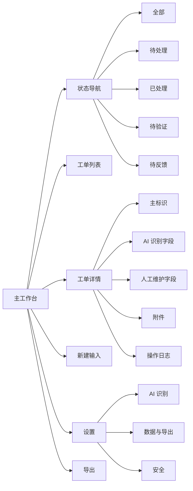

# 信息架构

## 1. 顶层结构



## 2. 主工作台布局

```text
┌────────────────────────────────────────────────────────────────────┐
│ 顶部导航：标题 / 全局搜索 / 设置 / 导出                              │
├──────────────┬─────────────────────────┬───────────────────────────┤
│ 左侧状态导航  │ 中部工单列表             │ 右侧工单详情               │
│              │                         │                           │
│ 全部          │ 搜索与排序               │ 本地工单号                 │
│ 待处理        │ 工单卡片                 │ 状态切换                   │
│ 已处理        │ 工单卡片                 │ 识别字段                   │
│ 待验证        │ 工单卡片                 │ 人工维护字段               │
│ 待反馈        │ 工单卡片                 │ 附件与日志                 │
├──────────────┴─────────────────────────┴───────────────────────────┤
│ 底部输入：文本 / 图片 / 创建工单                                      │
└────────────────────────────────────────────────────────────────────┘
```

## 3. 字段分组

### 3.1 系统字段

| 字段 | 展示位置 | 是否可编辑 | 说明 |
| --- | --- | --- | --- |
| 本地工单号 | 列表、详情顶部 | 否 | `LOC-{UUID v4}` |
| 创建时间 | 详情顶部、排序 | 否 | 数据落库时间 |
| 更新时间 | 详情辅助信息 | 否 | 任意字段变更后更新 |
| AI 来源 | 详情顶部、日志 | 否 | local / cloud / mixed |

### 3.2 AI 识别字段

| 字段 | 展示位置 | 是否可编辑 | 识别失败处理 |
| --- | --- | --- | --- |
| 反馈人 | 列表、详情 | 是 | 显示“待补充” |
| 问题概括 | 列表、详情 | 是 | 显示“待补充” |
| 问题描述 | 详情 | 是 | 显示“待补充” |
| 问题背景 | 详情 | 是 | 显示“待补充” |
| 操作菜单 | 详情 | 是 | 显示“待补充” |
| 反馈时间 | 列表、详情 | 是 | 默认系统当前时间 |

### 3.3 人工维护字段

| 字段 | 展示位置 | 是否可编辑 | 说明 |
| --- | --- | --- | --- |
| 状态 | 列表、详情 | 是 | 固定四个节点 |
| 外部工单号 | 列表、详情 | 是 | Jira/TAPD/禅道等 ID |
| 处理人 | 详情 | 是 | 自由文本 |
| 优先级 | 列表、详情 | 是 | 低 / 中 / 高 / 紧急 |
| 处理备注 | 详情 | 是 | 多行文本 |

## 4. 导航策略

- 首屏默认进入“全部工单”，并选中最近创建的一条工单。
- 筛选状态后，右侧详情展示筛选结果中的第一条工单。
- 新建工单成功后，无论当前筛选是什么，都切换到“全部工单”并选中新建项。
- 设置作为覆盖式弹窗或独立二级页，关闭后回到当前上下文。

## 5. 空状态

- 无工单：中部展示空状态，底部输入框保持可用。
- 搜索无结果：提示“没有匹配的工单”，保留清除搜索入口。
- 详情无选中：提示“请选择一条工单”。
- 无附件：证据区隐藏附件列表，仅显示上传入口。
