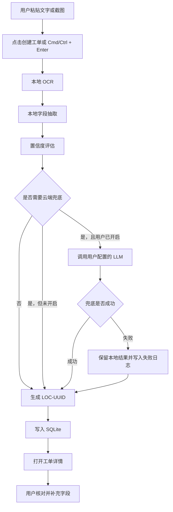
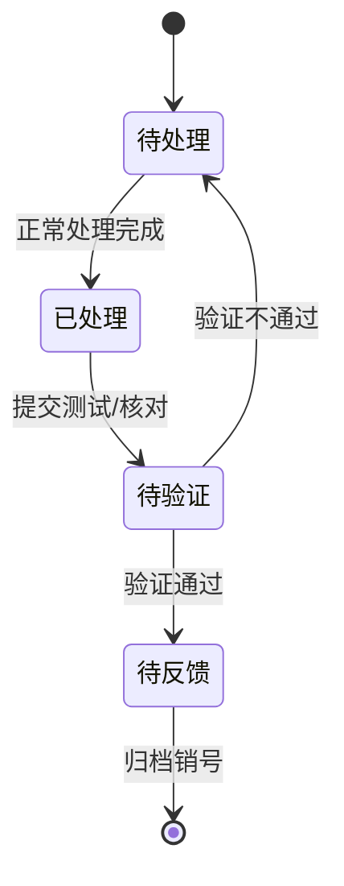
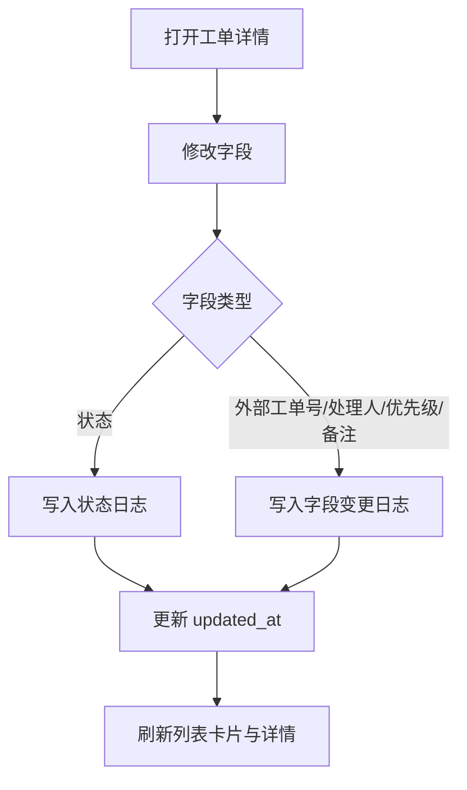
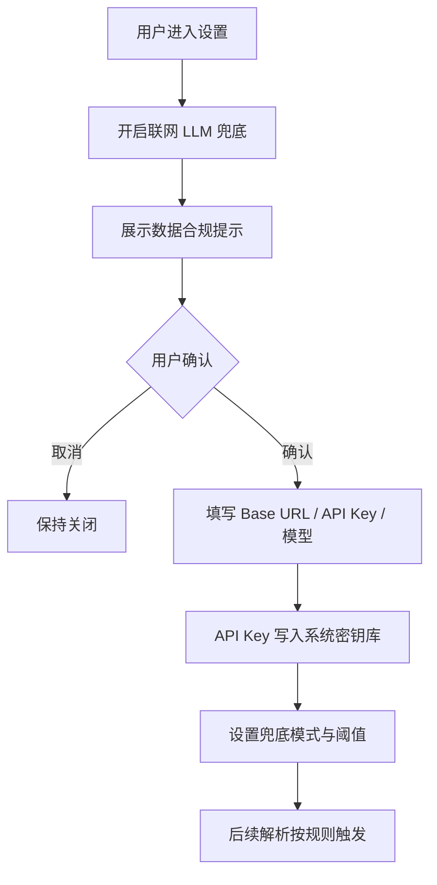
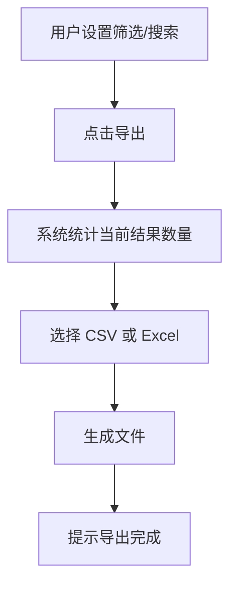

# 用户流程

## 1. 新建工单流程

### 关键规则

- 只有写入数据库成功后才生成最终本地工单号。
- 识别失败字段不阻塞创建。
- 云端兜底失败不阻塞创建。
- 新建成功后默认状态为“待处理”。

## 2. 状态流转流程

### 关键规则

- 状态节点固定，不允许用户自定义。
- 每次状态变更写入操作日志。
- 从“待验证”退回“待处理”时，建议要求填写退回原因。
- 归档销号需要二次确认。

## 3. 人工维护流程

## 4. 云端兜底流程

### 触发模式

- 关闭：不调用云端，默认模式。
- 手动：详情页展示“AI 重新识别”按钮。
- 自动：关键字段缺失或低于置信度阈值时调用。

## 5. 导出流程

### 导出规则

- 导出当前筛选结果，而不是全部数据。
- 第一列固定为完整本地工单号。
- 第二列固定为外部工单号。
- 附件默认不随表格导出，只导出附件数量与路径。

## 6. 异常流程

| 异常 | 处理方式 |
| --- | --- |
| OCR 失败 | 继续创建工单，截图保留为附件，字段显示待补充 |
| 本地 NLP 失败 | 使用用户原文作为问题描述，其他字段待补充 |
| 云端超时 | 降级为本地结果，日志记录超时 |
| UUID 冲突 | 重新生成一次；若仍失败，提示用户重试 |
| 数据库写入失败 | 不创建工单，保留输入内容并提示 |
| 导出失败 | 保留筛选条件，提示失败原因 |
